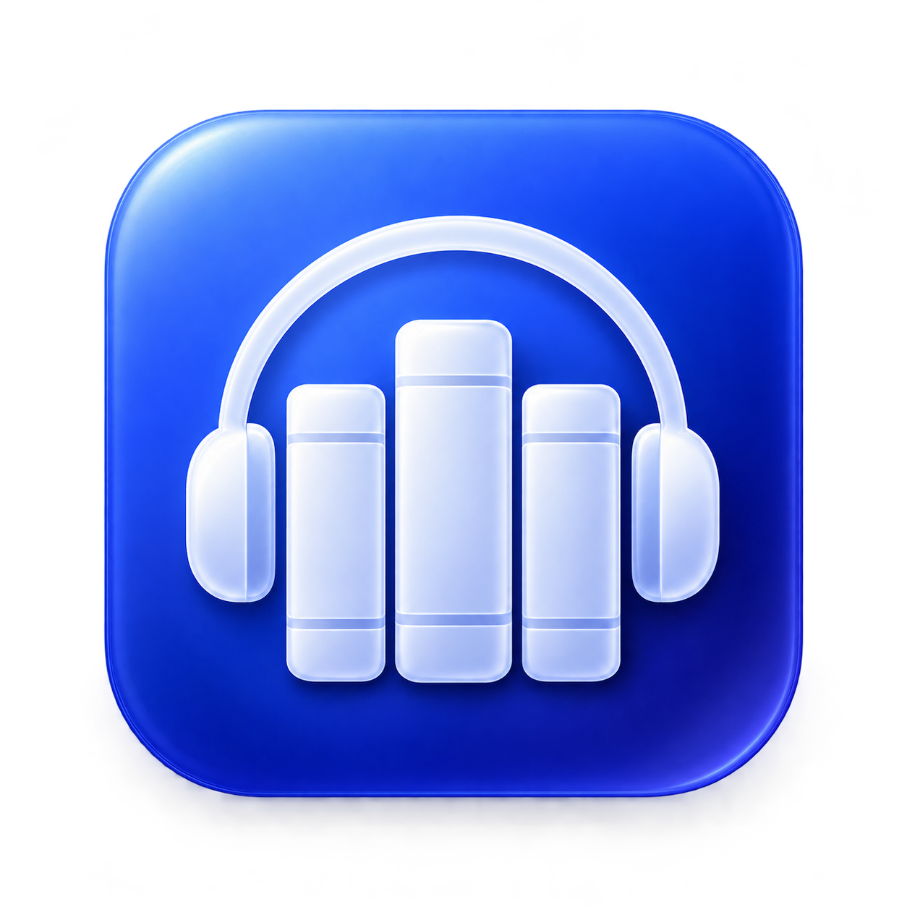

<p align="center">
  
</p>

<h1 align="center">Audisle</h1>

<p align="center">在 Mac 上收听你的 Audiobookshelf 书库。</p>

<p align="center">
  
  
  
</p>

<p align="center">
  <a href="#安装">安装</a> ·
  <a href="#功能">功能</a> ·
  <a href="#从源码构建">从源码构建</a> ·
  <a href="https://github.com/lvshp/audiobookshelf-Mac-audilse/issues">反馈问题</a>
</p>

Audisle 是使用 Swift、SwiftUI 和 AppKit 编写的原生 macOS 客户端，连接你自己的 [Audiobookshelf](https://github.com/advplyr/audiobookshelf) 服务器，支持有声书、播客和电子书。

这是一个独立客户端项目，与 Audiobookshelf 官方没有隶属关系。使用前需要已有的 Audiobookshelf 服务器和账号。

## 功能

- **有声书播放**：在线收听、章节跳转、书签、倍速、睡眠定时和待播队列。
- **离线收听**：下载到 Mac，断网后继续播放；重新联网后同步收听进度。
- **macOS 播放控制**：菜单栏播放器、系统媒体控制，关闭主窗口后继续播放。
- **书库浏览**：封面网格与列表、搜索、排序、筛选，以及作者、系列、集合和播放列表。
- **播客订阅**：搜索节目、添加 RSS、导入导出 OPML、选择单集下载和自动追更。
- **电子书阅读**：EPUB、PDF、CBZ、CBR，以及无 DRM 的 MOBI/AZW3 基础阅读。
- **收听记录**：历史记录、收听统计和年度回顾。
- **内容管理**：编辑元数据、封面、章节和音轨，上传文件，管理书库。
- **服务器管理**：用户与权限、会话、API 密钥、备份、日志及服务器设置。可用操作取决于账号权限。
- **多账号与语言**：切换服务器和账号，支持简体中文与 English。

## 安装

| 项目 | 要求 |
| --- | --- |
| 系统 | macOS 14 或更新版本 |
| 芯片 | Apple Silicon（M 系列） |
| 服务器 | Audiobookshelf 2.26+；功能适配基线为 2.37.1 |

安装包由 [GitHub Actions](https://github.com/lvshp/audiobookshelf-Mac-audilse/actions/workflows/build-macos.yml) 构建。打开一次成功的运行，在 **Artifacts** 中下载 `Audisle-arm64-…`，解压后打开 DMG，将 **Audisle.app** 拖入 **Applications**。

如果还没有成功的构建，仓库维护者需要先按 [自动打包说明](docs/GITHUB_ACTIONS.md) 配置 VLC 依赖。

应用使用 ad-hoc 签名，尚未经过 Apple 公证。首次打开可能需要在 macOS「系统设置 → 隐私与安全性」中确认允许打开。

## 连接服务器

1. 打开 Audisle，选择 **连接服务器**。
2. 输入服务器地址，例如 `https://books.example.com`。如果使用子路径，请包含完整路径，例如 `https://example.com/audiobookshelf`。
3. 使用服务器账号登录，选择书库即可开始收听。

收听进度通过你的 Audiobookshelf 服务器同步。音频下载到 Mac 后可以离线播放；本机账号凭据加密保存，登录密码不保留。

点击窗口左上角的关闭按钮后，音频会继续播放。可以通过菜单栏图标重新打开窗口；按 `⌘Q` 退出应用。

### 添加播客

在播客书库中点击 **订阅节目**，按名称搜索，或粘贴 RSS 地址。订阅后打开 **管理节目与单集 → RSS 选集**，选择要下载的节目。

播客单集先由 Audiobookshelf 下载到服务器。需要在 Mac 上离线收听时，再下载到本机。「自动检查并下载新单集」用于后续追更。

## 从源码构建

需要完整的 Xcode、Swift 6.1 或更新工具链，以及本项目使用的修补版 VLCKit 3.7.3。VLC 框架和对应源码材料单独提供，不包含在 Git 仓库中，准备方式见 [依赖说明](docs/GITHUB_ACTIONS.md#首次准备依赖) 和 [VLC 构建说明](Packaging/VLC/portable/README.md)。

导入已校验的框架后，在项目根目录运行：

```bash
bash scripts/build-app.sh
```

应用生成在 `build/Audisle.app`。生成 DMG：

```bash
bash scripts/package-dmg.sh build/Audisle.app build/delivery
```

运行测试：

```bash
bash scripts/test.sh
```

也可以使用 Xcode 打开 `ShelfMac.xcodeproj`，选择 `ShelfMacApp` scheme。工程和模块仍使用内部名称 ShelfMac。

## 反馈与贡献

遇到问题或有功能建议，欢迎提交 [Issue](https://github.com/lvshp/audiobookshelf-Mac-audilse/issues)。请附上 macOS、Audisle 和服务器版本，以及复现步骤；播放问题请注明音频格式和在线／离线状态。日志中请去掉密码、令牌及私人服务器信息。

欢迎提交修复、翻译和界面改进。语言资源的维护方式见 [本地化说明](docs/LOCALIZATION.md)，更多技术资料见 [文档目录](docs/README.md)。

## 许可证

项目原创代码采用 [Audisle Noncommercial License 1.0](LICENSE)，允许非商业使用、修改和分发；商业使用需要另行取得书面授权。

第三方组件遵循各自的许可证，详见 [第三方声明](docs/THIRD_PARTY_NOTICES.md)。分发包含 VLC 的应用时，请同时提供 [对应源码与许可材料](docs/VLC_DISTRIBUTION.md)。

感谢 [Audiobookshelf](https://github.com/advplyr/audiobookshelf)、[VideoLAN](https://www.videolan.org/)、[GRDB](https://github.com/groue/GRDB.swift)、[Socket.IO-Client-Swift](https://github.com/socketio/socket.io-client-swift) 和 [EPUB.js](https://github.com/futurepress/epub.js) 等项目。
